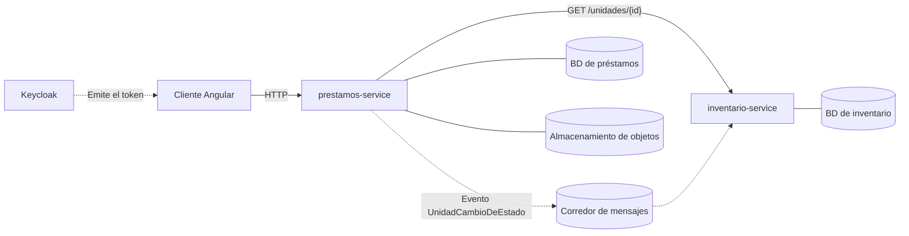

# GestiLab

**Sistema de préstamo de equipos de laboratorio.**

GestiLab es un sistema desarrollado por el equipo TEDE-SOFT para gestionar el inventario y los préstamos de equipos de laboratorio, controlar quién tiene cada unidad y durante cuánto tiempo, y conservar evidencias fotográficas de las entregas y devoluciones. Su atributo de calidad es la **modificabilidad (RQ-01)**, que busca facilitar la incorporación de nuevos tipos de equipo y sus reglas de préstamo sin modificar innecesariamente el código existente.

> Desarrollo de Software III · Equipo TEDE-SOFT · Atributo de calidad: **Modificabilidad (RQ-01)**.

## Arquitectura

GestiLab utiliza una arquitectura de dos microservicios independientes, cada uno con su propia base de datos. Se comunican mediante HTTP cuando necesitan una respuesta inmediata y mediante eventos cuando la información puede actualizarse de forma asíncrona.




| Servicio | Responsabilidad |
|---|---|
| `inventario-service` | Gestiona los tipos de equipo, las unidades, sus estados, el historial y las reglas de préstamo de cada tipo. |
| `prestamos-service` | Gestiona las solicitudes, las entregas, las devoluciones, los retrasos y el límite de unidades prestadas por persona. |

**Principio de diseño:** la duración máxima del préstamo y la necesidad de autorización previa son reglas asociadas al tipo de equipo y se administran en `inventario-service`. El servicio de préstamos consulta estas reglas y las aplica sin depender de una lista fija de tipos de equipo. Esta decisión favorece la modificabilidad y está registrada en `docs/bitacora.md` (D-01).


## Estructura del repositorio

```text
gestilab/
├── inventario-service/        # Tipos, unidades, estados y reglas
├── prestamos-service/         # Solicitudes, entregas, devoluciones y retrasos
├── docs/
│   ├── contrato/
│   │   └── openapi.yaml       # Contrato de GET /unidades/{id}
│   ├── guia-errores.md        # Formato común de errores
│   └── bitacora.md            # Decisiones de diseño
└── README.md
```

Cada servicio tiene su propia carpeta, su propio `pom.xml` y su propia base de datos. **Ningún servicio consulta directamente las tablas del otro**: cuando necesita información externa a su responsabilidad, la solicita mediante HTTP o la recibe a través de un evento.

## Versiones y herramientas

El equipo utilizará las siguientes versiones de referencia:

| Herramienta | Versión |
|---|---|
| Java (Eclipse Temurin JDK) | 21 LTS |
| Maven | 3.9.x |
| Spring Boot | 3.5.16 |
| PostgreSQL | 16 (`postgres:16-alpine`) |
| Docker | Versión compatible con Docker Compose |
| Git | 2.x |

**Spring Boot:** la versión de referencia es la **3.5.16**, la misma en `inventario-service` y en `prestamos-service`. Los servicios nuevos deben usarla también.

Imágenes de referencia para Docker y CI:

- Compilación: `maven:3.9-eclipse-temurin-21-alpine`
- Ejecución: `eclipse-temurin:21-jre-alpine`
- Base de datos: `postgres:16-alpine`

Acciones previstas para GitHub Actions: `actions/checkout@v4`, `actions/setup-java@v4` y `docker/build-push-action@v6`. La publicación de imágenes se realizará en GitHub Container Registry (GHCR).

## Puertos

| Servicio | API REST | Actuator |
|---|---:|---:|
| `inventario-service` | 8080 | 8081 |
| `prestamos-service` | 8090 | 8091 |

La API REST atiende a los clientes. Actuator expone datos de salud y operación del servicio; va en otro puerto para que esos datos no queden expuestos en el mismo puerto de la API.

## Convenciones de código

- **Organización por capas:** `domain/` contiene la lógica del dominio y sus excepciones; `delivery/` contiene los controladores REST y el manejo de errores.
- **Separación de responsabilidades:** el dominio no debe depender de la capa `delivery/`.
- **Rutas REST:** utilizar el prefijo `/api/v1/` seguido del nombre del servicio y del recurso.
- **Manejo de errores:** seguir el formato definido en `docs/guia-errores.md`.
- **Variables de entorno:** almacenar las credenciales y las URL de conexión en variables de entorno.
- **Protección de secretos:** no subir archivos `.env` al repositorio. Mantener un `.env.example` con los nombres de las variables y valores de ejemplo sin credenciales reales.

## Flujo de trabajo en equipo

1. `main` debe mantenerse compilable y con las pruebas aprobadas. No se permite hacer `push` directo a esta rama.
2. Cada tarea se desarrolla en una rama corta y específica, por ejemplo, `docs/acuerdos-previos` o `feat/contrato-unidad`.
3. Todos los cambios se integran mediante *pull requests*, revisados y aprobados por al menos una persona distinta de quien realizó el cambio.
4. Los commits deben tener mensajes claros y utilizar los siguientes prefijos:
   - `feat:` nuevas funcionalidades.
   - `fix:` correcciones de errores.
   - `docs:` cambios en la documentación.
   - `test:` incorporación o modificación de pruebas.
   - `ci:` cambios en integración continua.

## Documentación

| Documento | Propósito |
|---|---|
| [`docs/contrato/openapi.yaml`](docs/contrato/openapi.yaml) | Define el contrato del endpoint `GET /unidades/{id}`. |
| [`docs/guia-errores.md`](docs/guia-errores.md) | Define el formato común de errores y su catálogo. |
| [`docs/bitacora.md`](docs/bitacora.md) | Registra las decisiones de diseño, sus justificaciones y las alternativas descartadas. |


## Docker multi-stage e integración continua (CI)

Utiliza Docker y GitHub Actions para automatizar la compilación, las pruebas y la construcción de imágenes de sus dos microservicios: `inventario-service` y `prestamos-service`.

### Construcción de imágenes Docker

Cada microservicio cuenta con un Dockerfile multi-stage que utiliza dos etapas:

1. **Compilación:** utiliza Maven 3.9 y Java 21 para generar el archivo JAR.
2. **Ejecución:** utiliza Eclipse Temurin 21 JRE, incluyendo únicamente lo necesario para ejecutar la aplicación.

Para construir las imágenes desde la raíz del proyecto:

```bash
docker build -t gestilab/inventario-service:local ./inventario-service
docker build -t gestilab/prestamos-service:local ./prestamos-service
```

### Verificación de salud

Se comprobó el funcionamiento de ambos microservicios mediante Spring Boot Actuator, utilizando sus respectivos puertos de administración.

| Microservicio | Endpoint                      | Resultado     |
|---------------|-------------------------------|---------------|
| Inventario    | `http://localhost:8081/salud` | HTTP 200 - UP |
| Préstamos     | `http://localhost:8091/salud` | HTTP 200 - UP |

### Pruebas automatizadas

GitHub Actions ejecuta automáticamente el workflow `CI - GestiLab` en cada push y pull request.

El job `test` compila ambos servicios y ejecuta sus pruebas mediante Maven.

**Resultados de las pruebas locales:**

- Inventario: 5 pruebas aprobadas.
- Préstamos: 7 pruebas aprobadas.
- Total: 12 pruebas aprobadas, sin fallos ni errores.

El job `docker-build` construye las imágenes de ambos servicios cuando las pruebas finalizan correctamente. Las imágenes no se publican en ningún registro.

### Protección de la rama principal

La rama `main` cuenta con una regla de protección que exige Pull Request, aprobación de un integrante del equipo y ejecución satisfactoria del job `test` antes de integrar cambios.

### Evidencias de GitHub Actions

**Ejecución exitosa en la rama de desarrollo:**

https://github.com/GestiLab/gestilab/actions/runs/41661131559

**Detección de fallo intencional (CA-5):**

https://github.com/GestiLab/gestilab/actions/runs/41664259606

Se implementó una prueba JUnit con un fallo controlado en la rama `test/ci-fallo-controlado`. GitHub Actions detectó el error y finalizó el job `test` con estado `failure`, demostrando el funcionamiento del mecanismo de detección de errores.

Esta rama de ensayo no debe integrarse en `main`.

**Ejecución exitosa en main (CA-6):**

PENDIENTE: agregar el enlace directo a la ejecución verde después de integrar el Pull Request.

### Tecnologías utilizadas

- Java 21
- Spring Boot 3.5.16
- Maven 3.9
- Docker multi-stage
- GitHub Actions
- JUnit 5
- PostgreSQL 16


## Equipo

**TEDE-SOFT**

Proyecto académico de la asignatura Desarrollo de Software III.
